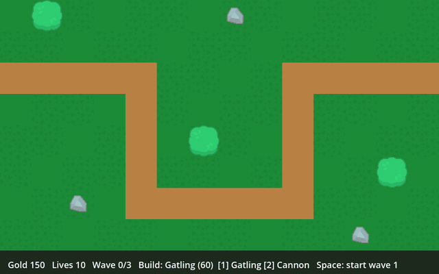

# Godot Tower Defense Core Lite – Godot 4 tower defense starter (free, MIT)

**Godot Tower Defense Core Lite is a free, MIT-licensed Godot 4 tower defense starter kit / project template in typed GDScript.**

[](https://godotengine.org) [](LICENSE) [](tools/run_tests.sh) [](https://huginhelm.itch.io/godot-tower-defense-core)

- **Engine:** Godot 4.7 (tested on 4.7.2) · **Language:** typed GDScript · **Licence:** MIT
- **Tests:** 54 headless checks passing (`bash tools/run_tests.sh`)
- **Website:** https://openclawaimac.github.io/godot-tower-defense-core/ · **Pro edition (€6, 128 tests, commercial EULA):** https://huginhelm.itch.io/godot-tower-defense-core
- **For AI agents:** [AGENTS.md](AGENTS.md) · [llms.txt](llms.txt)



## Quickstart
```bash
git clone https://github.com/openclawaimac/godot-tower-defense-core-lite.git && cd godot-tower-defense-core-lite
godot --headless --path . --import      # first import (registers class_name scripts)
bash tools/run_tests.sh /path/to/godot  # expect: RESULT: PASS 54 checks
godot --path .                          # run the demo (or open project.godot and press F5)
```
To use it in your own game, copy `addons/td_core/` into your project.

## Lite vs Pro (summary)
| | Lite (this repo) | Pro |
|---|---|---|
| Price | Free | €6 |
| Licence | MIT | Commercial per-seat EULA |
| Headless tests | 54 | 128 |
| Same API | ✅ | ✅ (upgrade without code changes) |
| Where | https://github.com/openclawaimac/godot-tower-defense-core-lite | [https://huginhelm.itch.io/godot-tower-defense-core](https://huginhelm.itch.io/godot-tower-defense-core) |

Full comparison below and on https://openclawaimac.github.io/godot-tower-defense-core/

## Features
- `TDContent`: towers, enemies, waves and the map in one JSON file, with `validate()`
- `TDMap`: cell grid with path / blocked / buildable cells, world ↔ cell conversion, path validation
- `TDEnemy`: follows a polyline path; hp, speed, armor (flat reduction), slow, bounty, leak damage, flying flag
- `TDTower`: hitscan towers with FIRST / LAST / STRONGEST / CLOSEST targeting, splash, slow, air/ground filter, DPS readout
- Data-driven upgrade levels and sell refund (70% of gold spent)
- `TDWaveSpawner`: data-driven waves with per-wave HP scaling, wave-clear bonus, next-wave preview, placement rules, win/lose signals
- `TDEconomy`: gold, lives and a `defeated` signal
- Headless-friendly: `auto_tick = false` + `advance(delta)` drives the whole game from tests
- Playable 3-wave demo (`examples/lite_demo.tscn`) with Kenney CC0 sprites
- 54 strict headless checks

## Install
1. Download the release zip (or `git clone` this repo).
2. Open `project.godot` in Godot 4.7, or copy `addons/td_core/` into your own project.
3. Run the demo with F5. Controls: `1`/`2` pick tower, left click build, right click sell, `Space` next wave, `R` restart.

> **First open / re-import:** the repo ships without the `.godot/` cache. Open the project once in the editor (or run `godot --headless --path . --import`) so Godot re-imports the sprites and registers the `class_name` scripts before running the demo or the tests. If that first import crashes, just run it again – the second import finishes normally.

## Run the tests
```
tools/run_tests.sh /path/to/godot
# or: godot --headless --path . -s res://tests/run_tests.gd
```
Expected: `RESULT: PASS 54 checks, 0 failures`.

## Layout
```
addons/td_core/   TDContent, TDMap, TDEnemy, TDTower, TDWaveSpawner, TDEconomy
examples/         lite_demo.tscn (playable 3-wave demo), data/ (JSON content)
assets/           Kenney CC0 sprites + licences
tests/            strict headless suite
tools/            run_tests.sh (strict runner)
```

## Lite vs Pro
| Feature | Lite (free, MIT) | Pro (paid, EULA) |
|---|---|---|
| Core scripts: TDContent, TDMap, TDEnemy, TDTower, TDWaveSpawner, TDEconomy | ✅ same 6 scripts | ✅ |
| Targeting modes, splash, slow, air/ground, armor, flyers, upgrade levels, sell refund | ✅ | ✅ |
| JSON content (towers, enemies, waves, map) | Small sample: 2 towers, 2 enemies, 3 waves | ✅ 4 towers, 6 enemies, 12 waves |
| Playable demo | Minimal demo (build, sell, next wave) | ✅ full demo: HUD build bar, hover/upgrade panel, wave preview, win/lose screen |
| Camera pan/zoom, game speed, pause, mute | – | ✅ |
| Juice: recoil, muzzle flash, explosions, floating numbers | – | ✅ |
| Sprites (Kenney CC0) | ✅ | ✅ |
| Sound effects, jingles, music (CC0) | – | ✅ |
| Headless tests | ✅ 54 checks | ✅ 128 checks |
| Web export preset, capture tooling, design notes | – | ✅ |
| Licence | MIT | Commercial EULA (per seat) |

**[Get Pro on itch.io](https://huginhelm.itch.io/godot-tower-defense-core)**

## What Lite does NOT do
- One fixed path per map (no maze building / pathfinding); hitscan towers, no projectile physics
- No save/load, meta-progression, hero units or abilities
- No HUD, sound or music – wire the logic to your own UI and art

## Licence
Code: MIT (see LICENSE). Sprites: Kenney, CC0 (see ASSET_LICENSES.md and assets/sources/). The Pro edition is under a commercial EULA.
